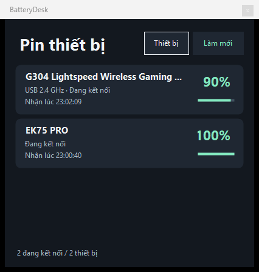

# BatteryDesk

 · [Tiếng Việt](README.vi.md) · [MIT license](LICENSE)

See the battery percentage of your mouse or keyboard next to the Windows 11 clock. BatteryDesk reads supported Bluetooth, USB receiver, and wired devices locally, without opening vendor apps.

[Download the Windows x64 preview](https://github.com/CharlieMinh/BatteryDesk/releases/tag/v1.0.0-rc.2) · [Check supported devices](docs/COMPATIBILITY.md) · [Report a device](https://github.com/CharlieMinh/BatteryDesk/issues/new/choose)

## Run the Windows candidate

1. Extract the self-contained Windows 11 x64 ZIP.
2. Run **BatteryDesk.exe**. The portable archive includes the .NET runtime.
3. Click a battery icon for details. Right-click the bar to switch between percentages, battery gauges, and one combined icon.

The preview UI is in Vietnamese. The executable is unsigned and the release includes a SHA-256 checksum for the ZIP.

## Verified hardware

| Device | Connection verified |
| --- | --- |
| Dareu EK75 PRO | Bluetooth LE and USB cable (`260D:0046`, including the charging flag) |
| Logitech G304 LIGHTSPEED | USB receiver (`046D:C53F`) |

Other Bluetooth devices may work if Windows or the device exposes a battery level. See the [compatibility matrix](docs/COMPATIBILITY.md) for verification details.

## Manage devices

Open **Thiết bị** (Devices) from the battery panel or **Thiết bị và lịch sử** (Devices and history) from its context menu. You can pin, rename, hide, reorder, and set per-device low-battery and charge-target alerts. Move a device up or down within its pin group.

Bluetooth and USB endpoints remain independent until you confirm that they belong to the same physical device. To join them, select the profile whose settings should be retained, select the other connection and confirm **Liên kết…**. You can separate the added connection later. A charge-target alert requires a confirmed below-target charging observation followed by a valid observation at the target.

When there is one EK75 PRO Bluetooth entry and one verified EK75 PRO cable entry, the overview shows one row if either connection is offline. Linking both connections of the same keyboard keeps one row even when Windows reports both connections as active.

## History and diagnostics

Enable local history under **Lịch sử**. The chart shows 24 hours or seven days with gaps for missing data. History is optional and can be cleared in the same tab. The support button under **Cài đặt** previews the selected device's model, connection, VID/PID when available, software versions, and normalized read status. The copy action only writes to the clipboard.

[Verified hardware and remaining tests](docs/COMPATIBILITY.md) · [Protocol provenance](THIRD-PARTY-NOTICES.md)

## Build

Install the .NET 10 SDK, then run on Windows.

~~~powershell
dotnet build BatteryDesk.slnx -c Release
dotnet test BatteryDesk.slnx -c Release
./scripts/Publish-Windows.ps1
~~~

Tagged Windows builds run the same package script in GitHub Actions and upload the ZIP and checksum as workflow artifacts.

See [CONTRIBUTING.md](CONTRIBUTING.md) to reproduce a reading, confirm a model, or add support for a device. [Protocol sources and bundled dependencies](THIRD-PARTY-NOTICES.md) are listed separately.
