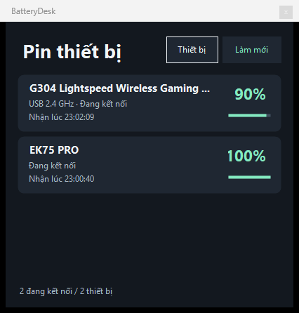

# BatteryDesk

[English](README.md)

Xem phần trăm pin của thiết bị Bluetooth và receiver USB tương thích ngay trên taskbar Windows 11 x64. BatteryDesk đọc dữ liệu tại máy và chạy với các thiết bị đã kiểm chứng mà không cần mở ứng dụng của hãng.

[Tải bản thử nghiệm Windows x64](https://github.com/CharlieMinh/BatteryDesk/releases/tag/v1.0.0-rc.2) · [Thiết bị đã kiểm chứng](docs/COMPATIBILITY.md) · [Gửi kết quả thử thiết bị](https://github.com/CharlieMinh/BatteryDesk/issues/new/choose)



## Sử dụng

1. Giải nén gói Windows x64 tự kèm .NET vào một thư mục.
2. Chạy **BatteryDesk.exe**. Thanh pin nằm trong hàng taskbar màn hình chính, ngay bên trái khu vực biểu tượng hệ thống. Nếu không xác định được vị trí khu vực đó, thanh pin hiện ngay phía trên taskbar. Số màu xám là lần đọc cuối hoặc chưa có dữ liệu. Bấm một ô pin để mở bảng chi tiết, hoặc dùng biểu tượng cạnh đồng hồ.
3. Bấm **Làm mới** hoặc F5 để yêu cầu cập nhật. Esc hoặc nút đóng sẽ ẩn bảng. Để dừng ứng dụng, bấm phải biểu tượng pin và chọn **Thoát**.

Bấm chuột phải vào thanh pin và mở **Kiểu hiển thị** để chọn **Số phần trăm**, **Vạch pin** hoặc **Một biểu tượng**. App đổi kiểu ngay và lưu lựa chọn cho lần mở sau. Bạn có thể bấm thanh pin ở bất kỳ kiểu nào để xem số chính xác của từng thiết bị.

Thanh pin dùng nền trong suốt để màu thật của taskbar hiện xuyên qua. Chữ và biểu tượng được vẽ ở độ phân giải điểm ảnh của màn hình. Bạn có thể bấm cả khoảng trống quanh biểu tượng trong mỗi ô pin.
Biểu tượng chuột, bàn phím, tai nghe và tay cầm dùng bộ nét bo trong chế độ **Số phần trăm** và **Vạch pin**.

Có thể chạy `BatteryDesk.exe --show` để mở luôn bảng chi tiết. Nếu muốn đổi ngưỡng cảnh báo mặc định 15%, tạo `%LOCALAPPDATA%\BatteryDesk\settings.json`, ghi ví dụ `{"lowBatteryPercent": 20}` rồi khởi động lại app. Ngưỡng hợp lệ từ 1 đến 99.

### Thiết bị, cảnh báo và lịch sử

- Bấm **Thiết bị** trong bảng pin để ghim, đổi tên, ẩn, sắp thứ tự hoặc đặt ngưỡng riêng. Nút **Lên** và **Xuống** đổi thứ tự trong nhóm ghim hoặc nhóm thường.
- Chọn **Liên kết…** sau khi nhận ra hai kết nối thuộc cùng một thiết bị vật lý. Hồ sơ đang chọn giữ cấu hình. Trang quản lý hiển thị mã ngắn để phân biệt thiết bị trùng tên. Bạn có thể tách kết nối đã liên kết.
- Khi phát hiện đúng một cặp Bluetooth và cáp EK75 PRO mà có kết nối đã ngắt, thanh pin và bảng pin chỉ hiện một mục. Liên kết hai kết nối của cùng chiếc bàn phím để giữ một mục cả khi Windows báo đồng thời hai kết nối.
- Cảnh báo mức sạc phát một lần sau khi có mẫu xác nhận đang sạc dưới ngưỡng rồi đạt ngưỡng. Rút cắm ở 100% và dao động nhẹ không tạo lại cảnh báo. Chọn **Khởi động cùng Windows** ở tab **Cài đặt** nếu muốn.
- Tab **Lịch sử** có chế độ 24 giờ và 7 ngày. Bật ghi để sử dụng. Dữ liệu lưu tại máy và có thể xóa. Biểu đồ bỏ trống các khoảng mất dữ liệu.
- **Sao chép thông tin hỗ trợ** mở nội dung xem trước cho thiết bị đang chọn. Sau khi xem, bạn có thể sao chép và tự dán vào issue.

Gói ứng viên hiện chưa ký Authenticode. Tệp SHA-256 đi kèm dùng để đối chiếu ZIP.

### Đọc thông tin pin

- **Nhận lúc** là thời điểm ứng dụng nhận mức pin qua BLE GATT hoặc Logitech HID++.
- **⚡** trên thanh pin của EK75 PRO cho biết bàn phím báo trạng thái sạc qua cáp USB. Bảng chi tiết hiển thị **Đang sạc** hoặc **Đầy pin** khi mức báo đạt 100%. Trạng thái sạc mất hiệu lực nếu chưa nhận được dữ liệu mới.
- **Windows báo · chưa rõ thời điểm** là mức Windows đang cung cấp. Windows có thể giữ giá trị trước đó.
- **Lần đọc cuối** là một giá trị trực tiếp trước đó vẫn được giữ lại khi mất kết nối hoặc đọc lại lỗi. Nếu chưa từng có mẫu, ứng dụng hiển thị **Chưa có dữ liệu pin**.
- Cảnh báo xuất hiện một lần mỗi đợt pin yếu khi nhận được mẫu trực tiếp hoặc quan sát thấy mức Windows thay đổi trong cùng một kết nối. Windows có thể ẩn thông báo theo cấu hình hệ thống.

### Chẩn đoán

```powershell
.\BatteryDesk.Probe.exe
.\BatteryDesk.Probe.exe --json
.\BatteryDesk.Probe.exe --watch
.\BatteryDesk.Probe.exe --usb-only --json
```

CLI hiển thị kết quả GATT và Windows riêng để đối chiếu. Với receiver, CLI ghi VID/PID và tính năng HID++ trả số pin. `--watch` đọc lặp khoảng mỗi 10 giây để chẩn đoán, dừng bằng Ctrl+C. Chế độ `--json` xuất một đối tượng JSON mỗi dòng cho mỗi thiết bị tìm thấy.

## Tương thích

[Bảng bằng chứng theo model và kết nối](docs/COMPATIBILITY.md) · [Nguồn tham khảo giao thức](THIRD-PARTY-NOTICES.md)

| Model | Kết nối | Đã xác minh |
|---|---|---|
| EK75 PRO | Bluetooth LE | 50% qua GATT và 50% qua Windows trên máy thử |
| EK75 PRO | Cáp USB 260D:0046 | Firmware báo 100% và trạng thái sạc trên máy thử khi Bluetooth tắt |
| Logitech G304 LIGHTSPEED | USB 2.4 GHz, receiver 046D:C53F | 90% qua HID++ 0x1000 trên máy thử |

Bluetooth Classic dùng mức Windows cung cấp khi profile và model hỗ trợ. Receiver đã kiểm thử là Logitech LIGHTSPEED 046D:C53F với G304. Khi G304 ngừng trả lời hoặc mất kết nối, bảng có thể giữ mức pin đã đọc với nhãn **Lần đọc cuối**. Thiết bị BLE có nhiều Battery Service hoặc nhiều mức pin trong cùng dịch vụ cần xác định từng thành phần trước khi chọn cách hiển thị.

## Phát triển

Cần .NET 10 SDK trên Windows. `BatteryDesk.Core` chứa mã tìm thiết bị, đọc pin và quản lý mẫu dùng chung cho WinForms và CLI.

```powershell
dotnet build BatteryDesk.slnx -c Release
dotnet test BatteryDesk.slnx -c Release
dotnet run --project BatteryDesk.Probe -c Release -- --json
dotnet run --project BatteryDesk -c Release
```

Ứng dụng theo dõi Bluetooth và USB HID qua Windows DeviceWatcher. BLE ưu tiên thông báo GATT khi thiết bị cho phép. Receiver và thiết bị BLE cần đọc lại được kiểm tra khoảng mỗi 5 giây khi phản hồi, với thời gian chờ từng yêu cầu và khoảng thử lại tăng dần khi lỗi. App chỉ hiển thị phần trăm do thiết bị hoặc Windows trả về. Cả hai loại kết nối dùng chung giới hạn hai lượt đọc đồng thời.

Tham chiếu giao thức và API. [Windows HID](https://learn.microsoft.com/en-us/windows-hardware/drivers/hid/opening-hid-collections) · [Receiver Logitech trong Solaar](https://github.com/pwr-Solaar/Solaar/blob/master/lib/logitech_receiver/base_usb.py) · [Tính năng pin HID++](https://github.com/pwr-Solaar/Solaar/blob/master/docs/features.md) · [Lệnh đọc pin Togran](https://github.com/notjiccu/wireless-device-battery-monitor/blob/main/src/drivers/dareu.cpp)

Để lặp lại phép đo trên desktop Windows, thoát BatteryDesk nếu đang chạy rồi mở PowerShell tại thư mục mã nguồn. Truyền đường dẫn bản Release và tên thiết bị đang kết nối như ví dụ.

```powershell
.\scripts\Verify-Hardware.ps1 -Executable 'C:\duong-dan\BatteryDesk.exe' -DeviceName 'EK75 PRO'
```
